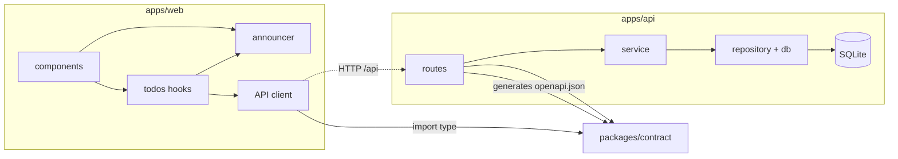
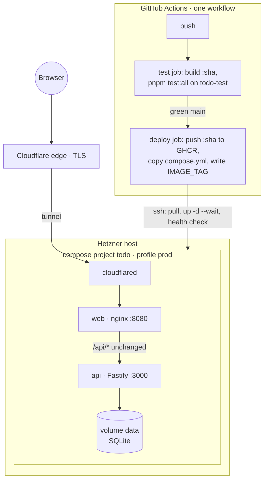
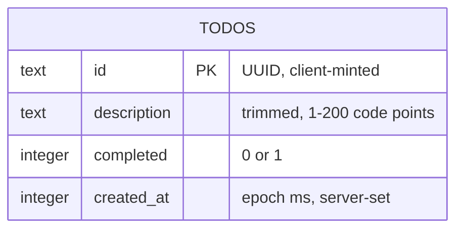

# Architecture Spine — Todo App v1

## Design Paradigm

**Layered three-tier**: a React SPA, a REST API, and an embedded SQLite store. Each layer depends only on the layer below it. The **contract** (`packages/contract`) is the only thing the web and API tiers share. It holds the TypeBox schemas, which are the single source for both validation and types.

| Layer | Lives in | May depend on |
| --- | --- | --- |
| Web · components | `apps/web/src/components/` | Web · todos hooks, announcer |
| Web · todos hooks (server state) | `apps/web/src/todos/` | Web · API client, announcer, `packages/contract/src/description.ts` (runtime) |
| Web · API client | `apps/web/src/api/` | `packages/contract` (`import type` only) |
| API · routes (HTTP) | `apps/api/src/routes/` | API · service, `packages/contract` |
| API · service (domain rules) | `apps/api/src/todos/service.ts` | API · repository |
| API · repository and db (persistence) | `apps/api/src/todos/repository.ts`, `apps/api/src/db/` | Drizzle, SQLite |
| Contract | `packages/contract` | `typebox` only |



## Invariants & Rules

### AD-1 — The images that are tested are the images that run in production [ADOPTED]

- **Binds:** C6, C7, C11, C12, R16, R22
- **Prevents:** Dev, test and prod running different runtimes or artifacts, and a deploy that rebuilds what CI tested.
- **Rule:** Production runs the `api` and `web` images that CI built and tested for that git SHA, under the compose project `todo` on the Hetzner host, with the `prod` profile. No step after CI's test job builds an image. There is no Cloudflare runtime (no Workers, D1 or Containers). C12's Cloudflare hosting is replaced by this rule, and Cloudflare's only role is the ingress in AD-3.

### AD-2 — The API container is the only owner of the data [ADOPTED]

- **Binds:** R2, R10, R11, R12, C2
- **Prevents:** A second writer or reader of todo data, and lost data on restart.
- **Rule:** Todos live in one SQLite file at `DATABASE_PATH`, on the project's named `data` volume, which is mounted only into the API service. Exactly one API replica runs. No other service, script or container opens the file while the API runs. Production is never brought down with `down -v`.

### AD-3 — Public traffic enters through a Cloudflare Tunnel; production publishes no ports [ADOPTED]

- **Binds:** C7, R22
- **Prevents:** Host-port collisions on the shared host, and an origin certificate to place and rotate.
- **Rule:** In `prod`, a `cloudflared` service connects outbound to Cloudflare with `TUNNEL_TOKEN` and forwards the public hostname to `web:8080`. No `prod` service publishes a host port. Cloudflare terminates TLS. The hostname is public and unauthenticated in v1 (an accepted risk, see Deferred).

### AD-4 — The browser talks to one origin, and `/api` is never rewritten

- **Binds:** R10, R12, R20
- **Prevents:** CORS, prefix stripping by a proxy, a stale upstream after the API restarts, and HTML error pages reaching the client.
- **Rule:** The API registers every route under `/api` itself. The browser calls only relative `/api/*` paths. The web tier forwards `/api/*` to the API **with the path unchanged**: nginx in `test`/`prod`, and the Vite dev server proxy in `dev`. nginx proxies to a variable upstream with `resolver 127.0.0.11 valid=5s ipv6=off`, so it re-resolves `api` within 5 s of a restart (Docker DNS answers with a 600 s TTL, which nginx would otherwise honour). For `/api/*` it answers every upstream failure (502, 503, 504) from a named location with status `503`, `Content-Type: application/problem+json` (set with an empty `types {}`), and the literal body `{"type":"/problems/unavailable","title":"Service unavailable","status":503,"detail":"The service is unavailable. Try again shortly."}` (AD-9). The API enables no CORS and publishes no host port in any profile.

### AD-5 — One schema source; the contract is generated and committed

- **Binds:** C9, R10, R12, R17
- **Prevents:** Web and API disagreeing on a shape, and a contract that documents something other than what runs.
- **Rule:** Every request, response and problem schema is a TypeBox schema in `packages/contract`. API routes use those schemas, and the web gets types from them by `import type` only, never with hand-written API types. The one runtime import the web may make is the dependency-free `packages/contract/src/description.ts` (AD-8). `@fastify/swagger`, set to `openapi: '3.1.0'`, generates `packages/contract/openapi.json`, which is committed. CI fails if regenerating it produces a diff. `apps/web/src/api/` is one hand-written, typed `fetch` client. It is the only web code that sends HTTP.

### AD-6 — API surface and status semantics [ADOPTED]

- **Binds:** R1, R3, R4, R5, R10, R13, R15
- **Prevents:** Epics choosing different verbs, paths or status codes, and a retry or double-submit being reported as a failure.
- **Rule:**

| Method & path | Body | Success | Errors |
| --- | --- | --- | --- |
| `GET /api/todos` | — | `200` `Todo[]`, sorted by the server: `createdAt` desc, then `id` desc | — |
| `POST /api/todos` | `{ id, description }` | `201` new `Todo`; `200` stored `Todo` when the same `id` already exists with the same trimmed description (an idempotent replay) | `400`, `409` (same `id`, different content) |
| `PATCH /api/todos/{id}` | `{ description?, completed? }`, at least one | `200` full `Todo` | `400`, `404` |
| `DELETE /api/todos/{id}` | — | `204` | `404` |
| `GET /api/health` | — | `200 { "status": "ok" }` | `503` problem (`unavailable`) |

Every `/api` route can also answer `503` `unavailable` from nginx (AD-4), and `openapi.json` documents it on every route. There is no version prefix; a prefix comes only with a breaking change. There is no `PUT` and no bulk or reset endpoint.

### AD-7 — Todo shape and identity [ADOPTED]

- **Binds:** R1, R2, R4, R7, R13
- **Prevents:** Temporary-id handling in the client, and drifting field names, types and time formats.
- **Rule:** On the wire, a `Todo` is `{ id: string (UUID), description: string, completed: boolean, createdAt: string }`. **The client mints `id`** with `crypto.randomUUID()` before the mutation starts, and sends it on `POST`. The server sets `createdAt` (ISO-8601 UTC with milliseconds, e.g. `2026-11-23T21:33:00.000Z`) and sets `completed: false` on create. The repository alone converts between the wire format and storage.

### AD-8 — Strict validation: the server is the authority, and the client runs the same rule

- **Binds:** R1, R12, R13, U1, I2, I4, K1, K3
- **Prevents:** Create and edit applying different rules, client and server disagreeing on what's valid, silent coercion of bad input, and line breaks stored by one client that another can't render or edit.
- **Rule:** The API's Ajv runs with `coerceTypes: false` and `removeAdditional: false`, set through Fastify's `ajv.customOptions` because Fastify's defaults are the opposite (I11 proves the override). Every body schema has `additionalProperties: false`, and `null` is never valid. A `preValidation` step trims `description` with `String.prototype.trim`. The schema then requires, on the trimmed value and on both create and edit, 1–200 **Unicode code points** and no character from the class `[\p{Cc}\u2028\u2029]` (control characters, including `\n`, `\r` and `\t`, plus the line and paragraph separators), compiled with the `u` flag. That trimmed value is what gets stored. The server rejects these characters and never normalises them. One dependency-free module, `packages/contract/src/description.ts`, holds the character class, the limits and the check. It holds the class as a RegExp literal with the `u` flag, never as a plain string (where `\p` silently becomes `p`), and the schema's pattern is built from that literal's source in the anchored, negated form `^[^...]*$`. The schema's pattern and length come from it, and the web imports it at runtime: the one runtime import AD-5 allows. Before sending, the client replaces each forbidden character with a space, then trims, then runs that check (counting `[...s].length`). The request body and the optimistic todo carry that exact value. One table of U1 cases runs against both the schema and the client check. A failure of the client check renders **inline** next to its input via `aria-describedby` and never goes through the announcer. A server `400` on a write that has already been applied optimistically is a mutation failure: the helper announces it (AD-13), with the `validation` reason only when the problem's `errors` names `description` (AD-14). The client sends only the fields it is changing. A rejected request changes nothing.

### AD-9 — Errors are RFC 9457 Problem Details, with a closed set of types [ADOPTED]

- **Binds:** R7, R12, C9, I2, I5, I7, I9
- **Prevents:** Each route or epic inventing its own error shape, and each client parsing several shapes.
- **Rule:** Every non-2xx response under `/api` is `application/problem+json`: `{ type, title, status, detail, errors?: [{ field, message }] }`. `field` is the bare property name (e.g. `description`). `type` is exactly one of the relative strings `/problems/{validation | not-found | conflict | unavailable | internal}`, which `packages/contract` defines from epic 1 onward together with the single `Problem` schema. `unavailable` means the service can't serve the request now: `/api/health` uses it when storage fails, and nginx uses it when the API can't be reached (AD-4). One Fastify error handler produces every API problem, and no problem contains a stack trace, SQL or todo text. The client classifies every failure as exactly one of three kinds: a **problem**, by its `type`; **`network`**, when `fetch` rejects and no response arrived, except when the caller's own signal aborted it (a cancellation, AD-11); or **generic**, for a non-2xx response without a problem body (e.g. a Cloudflare HTML error page) or with an unknown `type`. One type, `FailureKind`, names the result: the problem's `type` name (`validation`, `not-found`, `conflict`, `unavailable` or `internal`), `network`, or `generic`. The todos store (AD-11), the per-call promise (AD-13) and the `messages.ts` keys (AD-14) all use it, so no layer narrows a problem to just "problem".

### AD-10 — API layering

- **Binds:** R10, R12, R15, C3
- **Prevents:** Business rules and SQL scattered across route handlers.
- **Rule:** Routes parse the request, call the service, and map the result to a response. The service owns the domain rules (existence, idempotent replay, ordering) and imports nothing from Fastify. Only the repository and `src/db/` (connection and migrations) touch Drizzle or SQL. The health route calls `repository.ping()`. The app is built by `buildApp({ config, db })`, which receives its config and database handle.

### AD-11 — Web layering and list states

- **Binds:** R3, R7, R9, R12
- **Prevents:** Components fetching directly, the list disappearing when a refetch fails in the background, a false "empty" list when an optimistic add fails before the first load, late failures from silent retries, and a background refetch erasing an optimistic change.
- **Rule:** Components read and change todos only through the hooks in `apps/web/src/todos/`. Only those hooks call the API client. The list uses one query key, `['todos']`, and renders the order the server returned, except that an optimistic add goes on top.
  - **One store, one observer.** The client state that is not the cache lives in one **todos store**, created with the `QueryClient` and provided beside it. It holds **loaded**, **last fetch failure** (the `FailureKind` of the most recent recorded fetch failure, AD-9, or none; "the last fetch failed" means it is not none), **retry requested**, the pending-mutation count (AD-13) and the revert records (AD-13). Hooks read it with `useSyncExternalStore`, and no hook instance or component keeps its own copy. Exactly one component, the list area, observes `['todos']`.
  - **Fetch outcomes are recorded once, by the query function.** It passes the query's `signal` to the API client. A fetch that ends with that signal aborted is a cancellation: it records nothing and announces nothing, and it is never `network`. The signal is checked after the last `await` as well, so a result that arrives after a cancellation records nothing. A success first writes the list into the cache with `setQueryData`, and only then sets loaded and clears last fetch failure and retry requested, so no render sees loaded with the cache from before the fetch. A failure records its kind as last fetch failure, replacing any earlier kind, clears retry requested and, once loaded, announces a `refresh` failure (AD-14). That is the only place a refresh failure is announced. Cache writes never touch these facts. The error panel and the loading status take their reason from last fetch failure, never from the query's `error`, which an optimistic cache write clears.
  - **List state comes from the store, not from the cache.** While not loaded, the list is in its error state when the last fetch failed and no retry is requested, and in its loading state otherwise. Any todos in the cache (only optimistic adds can be there) render above the skeletons or the error panel. A focus, reconnect or invalidation fetch changes the state only when its outcome is recorded. Once loaded, the list renders the cache (populated or empty), and a failed fetch keeps the list. One selector in the todos hooks derives the list state (loading, error, populated or empty) from the store and the cache, and every reader, the loading status included, uses it.
  - **Query policy:** `retry: false` and `networkMode: 'always'`, so an offline browser fails fast as `network` instead of pausing. `refetchOnMount`, `refetchOnWindowFocus` and `refetchOnReconnect` are set explicitly, each to a predicate that is true only when the pending-mutation count is 0. Try again calls a hook function that sets retry requested and fetches only when the count is 0. Otherwise the invalidation that AD-13 runs when the count reaches 0 is the fetch. `enabled` is not used for this gate.
  - Components hold no copy of server state, with one exception: a row the user confirmed for deletion may stay rendered, `inert` and `aria-hidden`, for its exit motion only. If that todo's id comes back into the cache (a failed delete), the leaving copy unmounts at once and the restored row mounts fresh. A row that a refetch removes unmounts at once.

### AD-12 — The repository is the seam for owners later (C1)

- **Binds:** C1
- **Prevents:** A second data-access path that a future owner or auth change would miss, and a speculative column now.
- **Rule:** No `owner_id` column and no auth code in v1. Because every read and write goes through the repository (AD-10), adding owners later means a migration, a repository filter and an auth plugin. No existing route, service signature or wire field changes, though new fields may be added.

### AD-13 — One optimistic-mutation helper for every write

- **Binds:** R7, R12, U4, U5, E6
- **Prevents:** Add, edit, complete and delete each inventing their own optimistic, rollback or race logic; one mutation's rollback or refetch overwriting another's change; outcome messages lost when a card unmounts or a second call is made; false messages from follow-ups to a create that failed.
- **Rule:** Every todo mutation, including create, goes through one helper in `apps/web/src/todos/`. The helper:
  - cancels in-flight `['todos']` fetches, then applies the change to that one todo in the cache at once (before the first load, too: AD-11 keeps the list state honest)
  - sends a given todo's requests to the server in the order the user acted, so a `PATCH` or `DELETE` never overtakes its own todo's `POST`
  - keeps the **pending-mutation count** in the todos store (AD-11): every todo mutation, sent or queued, is counted. A mutation leaves the count before the helper's settle step, and a dropped follow-up leaves it when it is dropped.
  - on failure, reverts only that todo's change (it never restores a whole-list snapshot), records the revert time for that todo in the store, and announces the failure (AD-14)
  - when a create fails, drops that todo's queued follow-ups. A dropped follow-up is neither a success nor a failure: it is not sent, not announced and not reverted.
  - announces `Added` and `Deleted` on server confirmation (AD-14)
  - invalidates `['todos']` when the pending count reaches 0, after failures as well as successes
  - runs every mutation with `networkMode: 'always'` and retries nothing automatically
  
  A `404` on `DELETE` counts as success. The helper, not a component, owns every mutation-outcome announcement and the revert records, so neither depends on a component staying mounted. Components get two signals:
  - a **per-call promise** that resolves, and never rejects, with that call's outcome: `ok`, `failed` (with its `FailureKind`, AD-9) or `dropped`, which components ignore. Components use it for local reactions, such as restoring a failed add's text or keeping a failed edit's draft.
  - **`revertedAt(id)`**, read from the store outside the cached `Todo` objects (AD-7), so a card re-mounted after a failed delete still shows its revert.
  
  Per-call `mutate(vars, { onSuccess, onError })` callbacks are not used, because they fire only for the latest call and not after the component unmounts.

### AD-14 — One visible announcer for outcome messages

- **Binds:** R7, R9, R12, R14 (WCAG 4.1.3)
- **Prevents:** Each component rendering its own alert or toast, which leads to duplicated or missing screen-reader announcements and failures a sighted user never sees; a background refresh failure overwriting the message that names the failed todo.
- **Rule:** One app-level region, visible on screen and marked `aria-live`, carries mutation-failure, refresh-failure and mutation-status messages. Its API is `announce(kind, text)`, with `kind` one of `failure`, `refresh` or `status`. A `refresh` message never replaces an undismissed `failure` message and is dropped. Any other message replaces the current one. Three callers exist and no others:
  - the helper, for mutation failures and status (AD-13);
  - the query function, for refresh failures (AD-11);
  - the list area, which announces “deleted elsewhere” with kind `failure` when a refetch removes a todo whose row is in edit mode, so the lost draft is never silent.
  
  All wording comes from one module, `apps/web/src/todos/messages.ts`, keyed by action and by `FailureKind` (AD-9). The `validation` reason applies only when the problem's `errors` names `description`; any other `validation` problem gets the generic reason. No component renders another toast or alert for a mutation outcome. Two exceptions sit outside the region:
  - field validation from the client check, which stays inline (AD-8), spoken by at most one hidden field status per text field;
  - the list's one loading status, which speaks only about the first load (AD-11): progress when the list enters its loading state, the error panel's text when it enters its error state, and at most one recovery line when the list becomes loaded, only if it has spoken earlier in the page session. "Has spoken" means it has set a non-empty line, even one emptied since; a delayed line that never fired doesn't count. A new failure kind while the list is already in its error state is not an entry and is not spoken. Becoming loaded cancels any pending line or delay, and once loaded it is silent. The list area renders it, always mounted and visually hidden, outside the part that swaps between list states and outside any `aria-busy` element, and decides its line in the same commit as any focus move. The announcer never carries a load failure or a load recovery.
  
  No other live region exists.

### AD-15 — Writes are atomic, and the schema migrates forward at startup

- **Binds:** R11, R12, I2, I4, I6
- **Prevents:** Half-written todos, environments on different schemas, and two stories editing one migration.
- **Rule:** Each write request runs as one SQL statement or one transaction, and the repository returns the persisted row. Drizzle-kit migrations are committed and applied by the API at startup, before it listens. Every story that changes the schema adds a new migration. A merged migration is never edited, and migrations in v1 are additive only (new columns are nullable or defaulted).

### AD-16 — One compose file, three profiles, three project names, configuration from the environment

- **Binds:** C7, R16, R17, I6
- **Prevents:** Unwritable or forked compose files, a test reset wiping dev data, and configuration baked into images.
- **Rule:** One `compose.yml` holds every service. Profiles and services are fixed in the Structural Seed table, and every environment runs under its own project name: `todo-dev`, `todo-test`, `todo`. Built services use `image: ghcr.io/abuabdillahi/bmad-todo-{api,web}:${IMAGE_TAG:-local}` together with `build:`. `APP_ENV` is `development`, `test` or `production`. All configuration comes from environment variables named in `.env.example`. The API validates them at startup and exits non-zero if any is invalid. No code reads `APP_ENV` to change behaviour, except for log formatting.

### AD-17 — Every service is health-checked, restartable, and logs to stdout

- **Binds:** R15, I7, C6
- **Prevents:** Health checks that probe different things, services without a health signal, an app that stays down after a host reboot, and logs filling the host's disk.
- **Rule:** Every compose service in every profile has a health check that uses only a binary already in its image:
  - `api`: Node fetching `/api/health`
  - `web` and `web-test`: `wget` fetching `/healthz`
  - `web-dev`: Node fetching the Vite port
  - `cloudflared`: `cloudflared tunnel --metrics 127.0.0.1:2000 ready`
  
  Services start behind `depends_on: condition: service_healthy`. Services in `test` and `prod` use `restart: unless-stopped`. Every service logs only to stdout and stderr through the `json-file` driver, with `max-size`/`max-file` rotation. The API logs JSON through pino with a request id.

### AD-18 — Delivery: one workflow that builds once, tests, then deploys from a green `main`

- **Binds:** R21, R22, C11
- **Prevents:** Untested images reaching production, out-of-order deploys, and deploys or rollbacks that need a person to finish them.
- **Rule:** One GitHub Actions workflow runs on every push:
  1. The **`test`** job builds both images tagged `<git-sha>` and runs `pnpm test:all` against them in `todo-test`. Its result shows on the commit.
  2. The **`deploy`** job (`needs: test`, `main` only, concurrency group `deploy-prod`, not cancelled in progress) pushes those same tags to GHCR. It then, over SSH, copies `compose.yml` at that SHA to the host, rewrites the whole host `.env` (mode 600) from GitHub secrets and variables plus `IMAGE_TAG`, logs the host into GHCR with the job's own `GITHUB_TOKEN`, runs `docker compose -p todo --profile prod pull`, logs out, runs `up -d --wait`, and checks that the public `/api/health` returns `200`. Any failure fails the workflow.
  
  Rollback is the same deploy run by hand (`workflow_dispatch`) with an earlier SHA.
  
  - **The deploy job's token is `packages: write`** (job permissions `contents: read`, `packages: write`). A job has one `GITHUB_TOKEN`, and this job both pushes the images and deploys them, so the host's pull uses that same write token.
  - **How the host holds it:** the token goes to the host only on the SSH session's stdin, never in a command argument or the host `.env`. On the host, `docker login ghcr.io --password-stdin` reads it and keeps it in the deploy user's Docker credentials for the pull, and a shell `trap` runs `docker logout ghcr.io` when the session exits, whether the pull succeeded or not. GitHub expires the token when the job ends, and the job's timeout is 20 minutes.
  - **Rejected for v1 (2026-11-25, user):** a separate `publish` job holding `packages: write`, so the deploy job, and the host, only ever get a `packages: read` token. It is a workflow change for a small gain. Take this path if the write token on the shared host becomes a concern.

### AD-19 — Security baseline

- **Binds:** R20, I8, C6
- **Prevents:** XSS, injection and secret leaks coming in through one epic's shortcut.
- **Rule:**
  - Todo text renders only through React's escaping. No `dangerouslySetInnerHTML` anywhere.
  - SQL goes only through Drizzle's parameterized queries.
  - nginx sends a strict `Content-Security-Policy` (`default-src 'self'`) and the standard security headers.
  - Images run as a non-root user.
  - Images, `compose.yml` and the repo hold no secrets. GitHub Actions secrets are the only source of production secrets. The host `.env` is generated by each deploy (AD-18) and never edited by hand. The host stores no long-lived registry credential.
  - Logs never contain todo text at `info` level or below.

### AD-20 — Test harness: where each layer runs and how it fails things

- **Binds:** R14, R17, R18, R19, C8, C9, C10, I1–I9, K1–K6, E1–E8
- **Prevents:** Epics building incompatible test setups: suites racing over one shared list, test-only switches in app code, coverage that can't be split by layer, and C9 resting on a manual tool.
- **Rule:**
  - **Unit and integration** tests run in-process through `buildApp`, on a temp SQLite file per test file with the committed migrations. I7's unhealthy case closes the db handle.
  - **Component** tests use Testing Library with MSW as the only HTTP stub. They never mock the hooks.
  - **Contract, profile, contract-unavailable and e2e** tests run against `todo-test`, reaching the API only through `web-test`'s origin (`E2E_BASE_URL`). `pnpm test:all` runs all four after it brings `todo-test` up, and `pnpm test` runs none of them. The contract suite validates every response against `openapi.json` with `Ajv2020` and `ajv-formats`. That suite is C9's "equivalent". Postman MCP, Playwright MCP and Chrome DevTools MCP are agent-side tools for development and debugging, never CI dependencies.
  - **E2e** runs with `workers: 1`. Each test empties the list through the public API in `beforeEach`. Failures are injected only with Playwright `page.route` (a problem response for "failing", `abort` for "unreachable"). App code has no test-only routes or flags.
  - **axe-core** runs in every e2e test with the tags `wcag2a`, `wcag2aa`, `wcag21a`, `wcag21aa` and `wcag22aa`. Every e2e project sets `reducedMotion: 'reduce'` (browser emulation, not an app flag), so no scan lands mid-transition. One motion-on spec, without axe, covers the default motion path. One spec takes the browser offline with `context.setOffline(true)` to prove that offline writes and loads fail at once instead of pausing (AD-11, AD-13). A second Playwright project with `colorScheme: 'dark'` reruns every axe-bearing spec, so both colour schemes are audited.
  - **Profile** tests (`apps/api/test/profile/`) run in `pnpm test:all` after e2e, one file at a time. They restart the `api` container with `docker compose` and prove a todo survives it (I6), read the `api` logs (JSON lines, a UUID request id, no todo text: AD-17, AD-19), and check `web-test`'s security headers (AD-19).
  - **Contract-unavailable** tests (`apps/api/test/unavailable/`) run last in `pnpm test:all`, which first stops `todo-test`'s `api` container and leaves `web-test` up. They check that every `/api` route answers with AD-4's literal `503` problem, never HTML. If the `api` won't stop, `pnpm test:all` skips them and fails.
  - **Vitest** has one project per layer: `unit`, `component` and `integration` in-process; `contract`, `profile` and `contract-unavailable` against `todo-test`. Coverage is reported per in-process project, and every project reports by scenario id.
  - **At each epic's close,** Lighthouse and the C4 performance profile run against `todo-test`. API p95 comes from at least 100 requests per endpoint.

## Consistency Conventions

| Concern | Convention |
| --- | --- |
| Naming | camelCase for JSON keys and TS identifiers; snake_case for SQL tables and columns (`todos`, `created_at`); PascalCase for React component files; kebab-case for other files |
| Ids and time | UUID strings (AD-7). `createdAt` is ISO-8601 UTC with milliseconds on the wire and epoch-ms `integer` in storage, converted only in the repository |
| Ports and env names | API listens on `PORT=3000`, nginx on `8080`, Vite on `5173`. `web-test` publishes `127.0.0.1:${TEST_WEB_PORT:-8081}` and `web-dev` publishes `127.0.0.1:5173`. Variables: `APP_ENV`, `PORT`, `DATABASE_PATH=/data/todos.db`, `LOG_LEVEL`, `IMAGE_TAG`, `TUNNEL_TOKEN`, `E2E_BASE_URL` |
| Errors | RFC 9457 with closed `type` URIs (AD-9). The client classifies each failure as a problem `type`, `network` or generic, and maps it through `messages.ts` (AD-14) |
| Styling | CSS Modules plus CSS custom-property tokens from the `bmad-ux` DESIGN.md. No CSS framework or CSS-in-JS |
| Accessibility | Native elements first (a checkbox for completion, buttons for actions, a form for add/edit), every control keyboard-operable with a visible focus ring, and WCAG 2.2 AA (R14) |
| Tests | Unit tests are `*.test.ts(x)` and component tests `*.component.test.tsx`, both beside the code. Integration tests are in `apps/api/test/integration/`, contract tests in `apps/api/test/contract/`, profile tests in `apps/api/test/profile/`, contract-unavailable tests in `apps/api/test/unavailable/`, e2e tests in `e2e/`. Test titles start with their scenario id (U/I/K/E) |
| One command | `pnpm test:all` brings up `todo-test`, runs every layer, writes coverage, and tears the project down |
| Toolchain | `packageManager: pnpm@12.23.0`. Dockerfiles install pnpm with `npm i -g pnpm@12.23.0` (Node 26 has no corepack) and CI uses `pnpm/action-setup`. `allowBuilds` lists `esbuild`. The TS configs list `types` explicitly (`node`, `vitest/globals`) |
| Reports | `docs/quality/<yyyy-mm-dd>-<epic>-<report>.md` (test-strategy Reports) |

## Stack

| Name | Version |
| --- | --- |
| Node.js (Active LTS) | 26.13.1 |
| pnpm | 12.23.0 |
| TypeScript | 6.0.3 |
| @types/node | 26.6.6 |
| Fastify | 5.12.8 |
| @fastify/swagger | 9.9.5 |
| @fastify/type-provider-typebox | 6.3.0 |
| typebox | 1.4.7 |
| ajv-formats | 3.0.1 |
| better-sqlite3 | 13.2.0 |
| @types/better-sqlite3 | 9.6.0 |
| drizzle-orm | 0.45.4 |
| drizzle-kit | 0.31.11 |
| React | 19.3.1 |
| Vite | 8.3.8 |
| @vitejs/plugin-react | 6.3.0 |
| @tanstack/react-query | 5.108.4 |
| Vitest + @vitest/coverage-v8 | 5.1.1 |
| @testing-library/react | 16.3.3 |
| @testing-library/dom | 10.4.2 |
| @testing-library/user-event | 14.6.13 |
| jsdom | 31.0.1 |
| MSW | 3.0.7 |
| Ajv (Ajv2020) | 8.20.0 |
| @playwright/test | 1.65.1 |
| @axe-core/playwright | 4.14.0 |
| nginx/nginx-unprivileged | 1.30-alpine |
| cloudflare/cloudflared | 2026.11.2 |

## Structural Seed

### Environments and deployment



| Profile | Project | Services | Host ports |
| --- | --- | --- | --- |
| `dev` | `todo-dev` | `web-dev` (Vite + HMR), `api-dev` (watch mode, source mounted, network alias `api`) | `127.0.0.1:5173` |
| `test` | `todo-test` | `api`, `web-test` (`extends: web`) — built images; volume removed on teardown | `127.0.0.1:${TEST_WEB_PORT:-8081}` |
| `prod` | `todo` | `api`, `web`, `cloudflared` — GHCR images at `IMAGE_TAG` | none |

### Data



### Source tree

```text
/
  compose.yml              # every service and profile (AD-16)
  .env.example             # every variable, no values for secrets
  .github/workflows/ci.yml # test → deploy (AD-18)
  apps/
    api/                   # Fastify; Dockerfile (multi-stage, non-root)
      src/routes/  src/todos/{service,repository}.ts  src/db/  drizzle/
      test/integration/  test/contract/  test/profile/  test/unavailable/
    web/                   # React + Vite; Dockerfile (build → nginx-unprivileged)
      src/api/  src/todos/{hooks,mutation helper,messages.ts}  src/components/  nginx.conf
  packages/contract/       # TypeBox schemas, Problem types, openapi.json (generated, committed)
  e2e/                     # Playwright + axe-core
  docs/quality/            # coverage, performance, accessibility and security reports
  README.md                # run, test, read logs, deploy, roll back, extend
```

## Capability → Architecture Map

| Capability / Area | Lives in | Governed by |
| --- | --- | --- |
| R1, R13 create and edit text | `web/todos`, API `POST`/`PATCH` | AD-6, AD-7, AD-8, AD-13 |
| R2 todo fields | contract, `todos` table | AD-5, AD-7 |
| R3 list on open, R9 empty, loading and error states | `web/todos`, components | AD-6, AD-11, AD-14 |
| R4 complete and reactivate | `PATCH { completed }` | AD-6, AD-13 |
| R5 delete (confirmed inline in the card, no undo; the confirm sends nothing) | `DELETE` on Confirm delete | AD-6, AD-13 |
| R6, R8 visual distinction, responsive | web components | `bmad-ux` DESIGN.md / EXPERIENCE.md; Conventions (Styling) |
| R7 instant, with revert | todos hooks | AD-13, AD-14 |
| R10 API | `apps/api` | AD-4, AD-5, AD-6, AD-10 |
| R11 persistence | SQLite volume | AD-2, AD-15, AD-17 (restart) |
| R12 invalid input, atomic writes, failures | contract, service, error handler, hooks | AD-8, AD-9, AD-11, AD-13, AD-15 |
| R14 WCAG 2.2 AA | web, e2e | AD-8, AD-14, AD-20, Conventions (Accessibility) |
| R15 health and logs | every service | AD-10, AD-17 |
| R16 environments | `compose.yml` | AD-16 |
| R17 suites, R18 coverage | Vitest projects, Playwright, `pnpm test:all` | AD-20, Conventions (Tests, One command) |
| R19 performance | `docs/quality`, `todo-test` | AD-20; C4 targets |
| R20 security | everywhere | AD-4, AD-8, AD-19 |
| R21, R22 CI and deploy | `.github/workflows/ci.yml` | AD-1, AD-18 |
| C1 owners later | repository | AD-12 |
| C2 server-side storage | API + SQLite | AD-2 |
| C3 simplicity | whole system | Paradigm, AD-10, AD-11 |
| C4 100 ms UI / 300 ms p95 | hooks, API | AD-13, AD-20 |
| C5 scope | — | Deferred |
| C6 hardened images, C7 compose | Dockerfiles, `compose.yml` | AD-16, AD-17, AD-19 |
| C8 tests from the tracer story onward | test harness | AD-20 |
| C9 machine-readable contract | `packages/contract` | AD-5, AD-9, AD-20 |
| C10 tooling | e2e, agent-side MCPs | AD-20 |
| C11 GitHub | Actions | AD-18 |
| C12 Cloudflare | ingress only | AD-1, AD-3 |

## Deferred

- **Access control on the public hostname:** accepted risk in v1, by user decision. Anyone with the URL can read and change the shared list. Revisit before the URL is shared beyond the team, or with C1's auth.
- **Backups of the SQLite volume:** out of v1, by user decision. Revisit before any real user relies on the deployed list, or if host-level snapshots turn out to be absent.
- **Visual design, layout, breakpoints, completion styling (R6, R8):** owned by a `bmad-ux` run (DESIGN.md + EXPERIENCE.md) before epic 1's UI stories. The spine fixes only the styling technology, the announcer and the data path.
- **Authentication, owners and multi-user:** out of v1 (C1). The seam is AD-12.
- **API versioning:** the first breaking change introduces a prefix (AD-6).
- **Horizontal scaling or Postgres:** single replica by AD-2. Revisit only if v2 needs concurrent writers. The move goes through the repository (AD-12).
- **Public hostname, tunnel token, deploy SSH user and key:** hitl setup in epic-todo-foundation. A one-time bootstrap creates the deploy user and its key, with Docker on the host. Secret values go only in GitHub secrets; their names go in `.env.example` and the workflow.
- **Monitoring, alerting, uptime checks:** out of v1, beyond `docker compose logs` and the post-deploy health check.
- **Rate limiting and abuse protection:** out of v1. Revisit with access control.
- **TypeScript 7:** pinned to 6.0.3 until typescript-eslint supports it.
- **drizzle 1.0 and Fastify 6:** stay on 0.45/0.31 and 5.x until they are stable. drizzle 1.0 changes the migration layout.
- **A write that fails with `network`, `unavailable` (e.g. an nginx 504) or a generic error may still have been applied.** The helper reverts it and announces a failure, and the next successful refetch shows what the server holds. For a create, that means the todo reappears, and resubmitting from the restored add field mints a new id, which creates a second todo. Accepted in v1. Revisit with a resubmit that reuses the failed id, which AD-6's idempotent replay makes safe.
- **Performance tuning:** measure against C4 first (R19). Indexes or caching only if a measurement calls for them.
